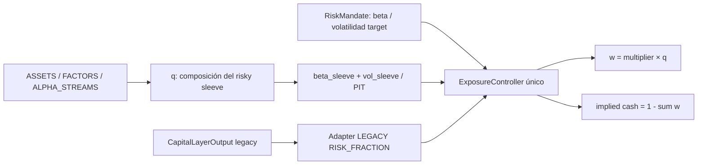

# AL-01 Amendment A — Risk mandate, beta semantics & exposure normalization

**PASS: 60/60 tests (36 originales + 24 nuevos), 15/15 criterios. Strict typecheck y git diff --check exit 0; 2.811 archivos preexistentes protegidos intactos.**

La arquitectura primaria es **RiskMandate → risky sleeve q con riesgo propio → ExposureController → cartera final y cash implementado**. MARKET_BETA es el modo de referencia. Cash/risk directo se conserva exclusivamente como LEGACY RISK_FRACTION. El AL01 anterior está archivado en `al01/amendment-a/baseline/`; se conserva su implementación y sus 36 tests.



## RiskMandate: primitive primaria

`contracts.ts` define RiskMandate version `allocation-risk-1.1.0`: as_of, policy id/version, state JSON, confidence nullable y semántica score/probability, primary target (MARKET_BETA/VOLATILITY/RISK_FRACTION, target, bounds nullable), constraints risky allocation/cash floor/ceiling/gross/net, exposure policy y provenance con cutoff/data/config hashes/generated_at/source IDs/availability/model identity. MARKET_BETA exige benchmark explícito compatible con beta_model. Beta es adimensional; VOLATILITY es anualizada decimal; RISK_FRACTION es fracción de NAV y sólo admite semantics=LEGACY con source trazable.

Cash no es objective ni primitive primaria. Floor/ceiling son constraints; no hay cash_budget en el nuevo mandate. Campos de un segundo cash target se rechazan. Confidence sólo es probability si se declara. generated_at no sustituye disponibilidad histórica. validateRiskMandate valida finitud, unidades declaradas, metadata/version, límites y canonical JSON hashing.

## Sleeve y modalidades preservadas

RiskSleeveAllocationResult (`allocation-core-1.1.0`) conserva ASSETS, FACTORS y ALPHA_STREAMS, weights por instrumento, unidades de risk capital, gross/net, snapshot/allocation IDs, constraints, residual, mode details, provenance y failures. Agrega **estimated_market_beta, estimated_volatility, asset_market_betas, beta_model, risk_model_provenance y risk_measurement_status**: estimaciones del sleeve antes de escalarlo. No se infiere beta=sum(weights).

Builders originales: ASSETS valida decisión suministrada, FACTORS sólo UNIQUE_SQUARE_EXACT sin regularización/pseudo-inversa, ALPHA_STREAMS agrega capital×unit maps con netting por instrumento. No hay nuevo optimizer. No se fabrica riesgo: entregan NOT_ESTIMATED y fields null hasta que attachSleeveRisk valide un artifact PIT suministrado. Está ligado al hash de q, beta por asset, volatilidad anualizada, benchmark/estimator/window y data/model/version/cutoff. Valida beta_sleeve=q' beta_assets. MARKET_BETA/VOLATILITY sin artifact AVAILABLE retorna INSUFFICIENT_DATA.

Gross=sum(abs(q)), net=sum(q). Long-only fully invested suma 1 dentro de 1e-10, residual exactamente cero. Signed conventions anteriores se conservan legacy; controller primario v1 sólo long-only fully-invested/no leverage. No se normalizan signed exposures para habilitarlo. Residual de mapping no se transforma en cash: bloquea composición y queda diagnóstico.

## ExposureController y composición

Contrato ExposureController y función pura **composeMandatedPortfolio(mandate,sleeve)** implementan LONG_ONLY_NO_LEVERAGE_V1; sin search/optimization/fitting:

```
beta_sleeve = Σ q_i * beta_asset_i
lambda_requested = target_beta / beta_sleeve
w_i = lambda * q_i
implied_cash_weight = 1 - Σ w_i
expected_final_beta = lambda * beta_sleeve
expected_final_volatility = lambda * vol_sleeve
```

Asume beta de cash=0 para esta identidad ex ante. VOLATILITY usa target_vol/vol_sleeve; RISK_FRACTION legacy usa target fraction directamente. Allocation/cash/gross/net/bounds del target forman un intervalo permitido de lambda. **REJECT por defecto**: target no realizable → INFEASIBLE, weights/cash ejecutables null y constraint_failures. **Sólo CLIP declarado** puede proyectar lambda al intervalo: conserva requested_target, risk conseguido, target_clipped=true y warning de target no logrado. Constraints contradictorios siguen INFEASIBLE incluso con CLIP.

No leverage v1 exige risky allocation<=1, pesos no negativos y cash en [0,1]. No modifica q ni sus signos/financiación para alcanzar el target. Output conserva lambda, beta/vol del sleeve, modelo/provenance, expected risk final, gross/net, implied cash, hashes e ID. No hay módulo posterior que vuelva a optimizar cash. Inputs no mutan; reordenar claves no cambia IDs/output.

**Tolerancias:** reconciliación weights/risk target/constraints 1e-10 absoluto. Umbral de división beta `64 × Number.EPSILON ≈ 1.4210854715202004e-14` adimensional: guard de roundoff a escala beta unitaria, derivado de precisión IEEE754, sin calibración económica. Abs(beta)<=umbral y target distinto de cero → INFEASIBLE; jamás redondear target no cero a cero. Beta≈0/target=0 puede dar lambda=0 si constraints permiten. Vol=0/target no cero bloquea. Varianza mercado cero en diagnósticos retorna undefined/INSUFFICIENT_DATA, sin epsilon en denominador.

## Compatibilidad LEGACY

CapitalLayerOutput es deprecated y no define el core. adaptLegacyCapitalOutput acepta 1.0.0/1.1.0 y genera RISK_FRACTION con semantics=LEGACY, budgets literales/source hash; no clipping ni cambio de cash/risk. upgradeLegacyRiskSleeve verifica hash antiguo y conserva weights/metadata, riesgo NOT_ESTIMATED; nunca beta=1 ficticia. composeFinalPortfolio permanece como adapter deprecated rotulado LEGACY_RISK_FRACTION. composeMandatedPortfolio es la vía principal. Esto conserva signed legacy sin concederle semántica de market-beta normalization.

AlphaStream/ALPHA_STREAMS son nombres técnicos de compatibilidad para strategy streams. Sus returns/P&L no son un claim de alpha estadística residual. No se crean streams/modelos financieros.

## Métricas canónicas, sin selection objectives

risk-metrics.ts sólo implementa aritmética diagnóstica de fixtures. MarketRiskConfiguration fija `market-risk-metrics-1.0.0`, benchmark, mínimo de pares, rolling window, DD threshold, tail q y métodos versionados. Usa pares <=information_cutoff: valores futuros no se consumen, validan ni hashean. Fechas elegibles únicas/ordenadas; returns elegibles NaN/Infinity/imposibles se rechazan.

| Nombre | Definición / units |
|---|---|
| market_beta | Cov(r_p,r_m)/Var(r_m); BETA |
| rolling_market_beta | Cov/Var últimas 63 sesiones por defecto; ventana completa; BETA |
| upside_beta | Cov/Var condicionado a r_m>0; BETA |
| downside_beta | Cov/Var condicionado a r_m<0; BETA |
| drawdown_beta | Cov/Var donde market DD<=threshold; default -10%; BETA |
| tail_beta | Cov/Var donde r_m<=Q_q(r_m); default q=5%; BETA |
| upside_capture | Ratio geométrico en días r_m>0; CAPTURE_RATIO |
| downside_capture | Ratio geométrico en días r_m<0; CAPTURE_RATIO |

Covariance y sample variance comparten n-1, que cancela en beta; se calculan en coordenadas trasladadas. Menos de minimum_observations (default 2) o market variance cero → null/INSUFFICIENT_DATA. Cada métrica conserva n/fechas/metodología/version/cutoff/data y config hashes.

DD: market wealth/high-water iniciales 1, causalmente desde primer par provisto; DD_t=wealth_t/max_{s<=t}wealth_s-1, threshold sin redondeo. No importa peaks ausentes anteriores: caller suministra historia suficiente o declara el origen. Tail LINEAR_TYPE7_V1: h=(n-1)q, interpolación de order statistics del prefijo disponible; <=incluye empates. No distribución futura.

Capture GEOMETRIC_SUBSET_DAILY_RATIO_V1, sobre mismo subconjunto U/D:

```
capture = [(Π(1+r_p))^(1/n)-1] / [(Π(1+r_m))^(1/n)-1]
```

Valor decimal 1.20 significa 120%, sin multiplicación por 100 en core. No annualiza el subset ni usa covariance. UI/reporting futuros deben consumir esta versión, no otra fórmula. Capture y beta tienen nombres/unidades diferentes.

## Alpha y scorecard: contratos, sin fitting

**Alpha estadística** es retorno residual de un modelo explícito. CAPM baseline:

```
r_p - r_f = alpha_daily + beta * (r_m - r_f) + epsilon
```

CapmAlphaResult separa alpha_annualized, alpha_t_stat, beta, beta_t_stat, model_spec y sample_start/end. Model spec declara benchmark, RF source, DAILY, anualización 252×intercepto diario y standard errors OLS homoskedastic o HAC Newey-West con lags. Regresión y t-stats **NOT_IMPLEMENTED** en AL01A, valores null; ninguna significancia inventada. Beta CAPM en excess returns no se confunde con beta raw/average beta ex ante.

PortfolioRiskAttribution contiene CAGR, annualized vol, DD, CVaR (q/método), average_beta, rolling summary, betas condicionadas, captures, CAPM alpha/t-stat separados, mean risky allocation/cash, turnover y costs, con metodología por métrica. Sin score único/ranking/selection objective. average_beta debe indicar promedio temporal de beta estimada ex ante; full realized beta va separado. Turnover/costos exigen unidad/metodología; no se calculan aquí. Campos no calculados null; ningún scorecard económico fue ejecutado.

## Distinciones y atribución

- **Risk management value:** reducir volatility/drawdown/tail exposure. No prueba retorno residual.
- **Capital efficiency:** retorno con menos beta/risk, frente a referencia comparable. No implica alpha.
- **Market-timing skill:** variación de beta que mejora resultados contra beta constante comparable. Cambiar cash no lo demuestra.
- **Allocation alpha:** residual producido por q_t después de controlar systematic exposure mediante modelo explícito. CAPM estático no separa por sí solo allocation de timing con beta dinámica.

**beta_portfolio(t) ≈ exposure_multiplier(t) × beta_sleeve(t)**; beta_sleeve(t)=q_t' beta_assets(t). Cambiar q cambia beta_sleeve, lambda para el mismo target y cash implementado. Capital/Allocation están modularmente separados pero no son independientes en market beta. Composer reconcilia estimates ex ante; realized beta puede diferir por estimación/dinámica/ejecución/cash returns. No se promete beta realizada exacta.

## Mapping, archivos, verificación

[AL01_existing_system_mapping.md](AL01_existing_system_mapping.md) identifica cash actual/totalCash B2, QP que modifica q, beta_sleeve/multiplier y adapters legacy necesarios. No corrige B2/calculator/B3.

Modificados: contracts.ts, validation.ts, composition.ts y dos reportes AL01. Agregados: risk-mandate.ts, adapters.ts, risk-metrics.ts, amendment-a.test.ts. Los 36 tests originales quedan idénticos. Baselines CL01/02/03/04, CRE, calculator, optimizers, routes/UI/DB/manifests/lockfiles intactos. Checkpoint/diff en al01/amendment-a/.

[Verificación por criterio/caso](al01/verification.json), [log final](al01/amendment-a/tests-final.txt), [comandos y exits](al01/amendment-a/commands.json), [typecheck](al01/amendment-a/typecheck.txt), [preservación](al01/amendment-a/preservation.json), [diff](al01/amendment-a/amendment.diff). Build esbuild existente, Node tests desde raíz, strict tsc --noEmit/--strict del core, git diff --check y whitespace nuevos. Sin instalación ni históricos recalculados, servicios producción/push/deploy.

## Límites

No optimizer/AL02/quality gates/Allocation Research Engine/UI/integración productiva. Beta/vol del sleeve son artifacts suministrados validados, no nuevo modelo entrenado de betas de assets. Beta/capture sólo pares provistos; sin nuevo histórico económico. Controller long-only/no leverage/residual cero/cash beta=0 asumido. Signed financiación continúa legacy. PIT/hashes declarados no autentican proveedores ni detectan etiquetas falsificadas. CAPM/scorecard completo son contratos, no resultados implementados; ninguna métrica se convierte en objetivo ni se declara alpha por menor DD/beta/más cash.

## Matriz de aceptación actualizada

| Criterio | Estado | Evidencia |
|---|---|---|
| 1. RiskMandate primary, MARKET_BETA reference; cash budget not primary | PASS | `risk-mandate.ts + main report` |
| 2. Explicit unscaled sleeve beta/vol/model/provenance | PASS | `contracts.ts + validation.ts + Risk estimates test` |
| 3. Exposure normalization and final beta reconciliation | PASS | `A/B/C tests + ExposureControllerResult` |
| 4. Single implementation cash controller; constraints enforced | PASS | `E/E2 + G original tests + primary validation` |
| 5. Beta/capture/alpha semantics separated and versioned | PASS | `risk-metrics.ts + CAPM/scorecard contracts` |
| 6. LEGACY RISK_FRACTION preserves budgets and adapters | PASS | `F/F2 tests + adapters.ts + composeFinalPortfolio LEGACY` |
| 7. Synthetic known-answer A/B/C | PASS | `tests-final.txt` |
| 8. Zero/nearly-zero risk and constraints failures | PASS | `D/E/E2 tests` |
| 9. Conditional beta and capture independent oracles | PASS | `G six beta and two capture tests` |
| 10. Past metrics immune to future observations | PASS | `H mutation test` |
| 11. Existing B1/B2/B3 q/cash/beta mapping updated | PASS | `../../AL01_existing_system_mapping.md` |
| 12. Original 36 tests unchanged and PASS | PASS | `test source checkpoint + tests-final.txt` |
| 13. Strict typecheck | PASS | `typecheck.txt` |
| 14. git diff --check and added-file whitespace | PASS | `diff-check.txt + whitespace-check.json` |
| 15. CL01/02/03/04 and production preserved | PASS | `preservation.json` |
