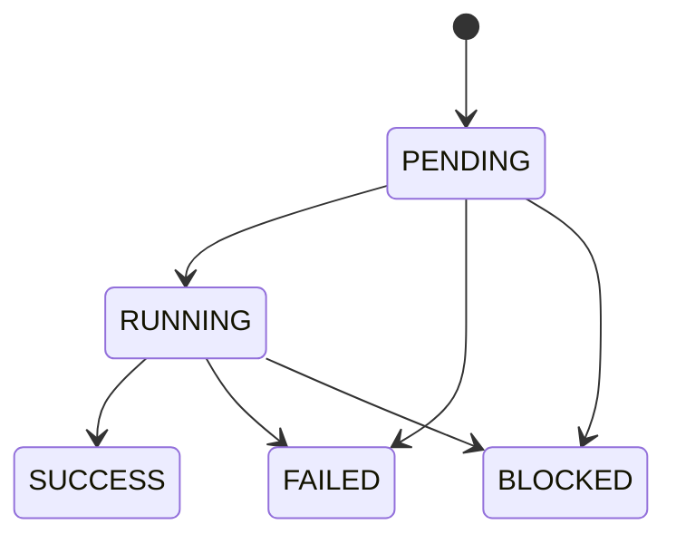

# Workbench Phase B1 temporary run-store contract

## Scope and storage classification

Phase B1 uses the filesystem-backed `WorkbenchRunStore` in `artifacts/api-server/src/lib/workbench/run-store.ts`. Its classification is always **`TEMPORARY_RESEARCH_STORAGE`** and its durability claim is **`NONE`**. It is an execution-evidence store for the research service, not a database, archival repository, order store, or real-money ledger.

The configured root is `WORKBENCH_RUN_DIR`; the development default is `/tmp/allocationlab-workbench-runs`. The root must be absolute. Before creating or changing anything, the store resolves the proposed location through its nearest existing ancestor and rejects a root that contains, equals, or is contained by the repository or another configured forbidden root. It repeats the overlap check after creation. Existing roots must be real directories owned by the current user; symbolic-link roots are rejected. The root is set to mode `0700`.

No HTTP value is accepted as a filesystem path. The server-configured root must be an absolute dedicated directory; filesystem root, the shared temporary root itself, repository/protected-root overlaps, and symlinks are rejected before mutation. A run directory is derived only from a validated `rr_<64 lowercase hex>` identifier, and an attempt directory is derived only from a validated `ea_<UUID-v4>` identifier.

## On-disk layout

```text
<WORKBENCH_RUN_DIR>/
  store.json
  .execution.lock                         # present only while one attempt owns the lease
  comparisons/                            # reserved; Phase B1 compare is read-only and does not write here
  runs/
    rr_<sha256>/
      ready.json
      run.json
      normalized-spec.json
      attempts/
        ea_<uuid-v4>/
          ready.json
          attempt.json
          states/
            pending.json
            running.json                  # written only if execution starts
            terminal.json                 # exactly one of SUCCESS, FAILED or BLOCKED
          engine/                         # fresh engine root, created by the fixed worker
          artifact-manifest.json          # written after engine termination and artifact sealing
          result.json                     # SUCCESS, FAILED and BLOCKED result envelopes
          diagnostic.json                 # detailed internal failure evidence
          safe-error.json                 # client-safe failure class and message
          blocker.json                    # explicit capacity or other blocker evidence
          logs/
            000000.log
            000001.log
            truncated.json                # present if the cumulative log limit is reached
```

`run.json` binds the deterministic run ID to the canonical normalized specification hash and identity digest. `attempt.json` binds an independent attempt ID to the run, its `SUBMIT` or `RERUN` source, and its request time. A rerun creates a new attempt directory and never reuses another attempt's `engine/` directory.

## Immutable publication

Store metadata is canonical JSON with recursively sorted object keys, preserved array order, finite JSON numbers, and a trailing newline. Each immutable record is published by:

1. creating a unique same-directory temporary file with `O_CREAT | O_EXCL | O_NOFOLLOW`, mode `0600`;
2. writing and `fsync`ing the content;
3. hard-linking it to the final name, which cannot replace an existing destination;
4. `fsync`ing the containing directory; and
5. removing the temporary name.

If the destination already exists, byte-identical content may be reused. Different content raises `IMMUTABLE_RECORD_CONFLICT`. Reads use `O_NOFOLLOW`, require a regular file, enforce the applicable size limit, and reject invalid or non-finite JSON.

The capital engine owns files under the fresh `engine/` directory while it runs. After the child exits, the store walks that directory, rejects links and non-files, checks size and file-count limits, and publishes an immutable manifest before the terminal success record.

## Status model and commit order

The implemented statuses are exactly:



`SUCCESS`, `FAILED`, and `BLOCKED` are terminal. A second terminal transition is rejected. Readers derive current status in the order `terminal.json`, `running.json`, then `pending.json`; no mutable status document exists.

Success publication order is engine completion, artifact quota and integrity scan, `artifact-manifest.json`, `result.json`, then `states/terminal.json`. Failure publication records `diagnostic.json`, `safe-error.json`, the failed `result.json`, and finally the terminal event. A blocked attempt records `blocker.json`, the blocked result, and then its terminal event. Thus a terminal marker cannot point to an absent result or diagnostic that should have preceded it.

A failed rerun remains the latest attempt and remains visible as failed. A prior successful result is retained separately; it does not overwrite or replace the failed evidence.

## Run identity, attempts and idempotency

`run_id` identifies one normalized financial experiment. `execution_attempt_id` identifies one actual execution. The same normalized specification is bound to one run directory; binding different bytes or another identity digest to that run ID is an immutable conflict.

The service serializes submission decisions with the store's in-process submission mutex. Its default POST behavior is:

- a matching `PENDING` or `RUNNING` attempt is returned and no duplicate starts;
- otherwise, an existing latest successful attempt is returned by default;
- if no success exists, the latest failed or blocked attempt is returned without an automatic retry;
- the explicit rerun endpoint creates a new attempt under the same run ID when capacity is available; repeated requests against the same active capacity blocker reuse one bounded `BLOCKED` attempt.

Run retrieval derives both `latest_attempt` and `latest_successful_attempt`, so a later failure is not hidden by an earlier success.

## Single-execution lease

Maximum concurrent empirical execution is one. Before an attempt enters `RUNNING`, the service atomically hard-links a unique lease record to `<root>/.execution.lock`. The record contains a random ownership token, run ID, attempt ID, process ID, host name, acquisition time, and deadline. Release checks the token before unlinking the lease.

If another attempt already owns the lease, one new attempt is finalized as `BLOCKED` with `BLOCKED_EXECUTION_CAPACITY`; it is not started in parallel. Repeated requests for the same run while that same lease remains active reuse the blocker instead of amplifying immutable metadata. Each run is capped at 100 immutable attempts; another request receives `ATTEMPT_LIMIT_REACHED` before creating a directory, while existing history remains readable. The current implementation does not silently reclaim a stale lease or retry an interrupted attempt. Operational recovery of a stale lease requires an explicit service-owner action; Phase B1 makes no high-availability claim.

## Bounds

| Resource | Bound |
|---|---:|
| Metadata file | 1 MiB |
| Cumulative stored log bytes per attempt | 1 MiB |
| Engine-output bytes per attempt | 64 MiB |
| Engine files per attempt | 512 |
| Runs or attempts returned by bounded listing | 100 |
| Immutable attempts stored per run | 100 |
| Concurrent empirical executions | 1 |

All configured limits must be positive safe integers. Log content beyond the bound is discarded and marked with `logs/truncated.json`.

## Artifact and reproducibility hashes

The sealed manifest lists each engine artifact by attempt-relative path, byte length, SHA-256, and class. `progress.json` and `storage-failures.jsonl` are classified `RUNTIME`; all other engine files are classified `FINANCIAL`. Entries are sorted by relative path.

The store-level `financial_result_hash` is SHA-256 over canonical manifest entries for every `FINANCIAL` file in the full dual-scenario campaign. The store-level `runtime_hash` is calculated the same way over `RUNTIME` entries. Runtime timestamps, memory readings, counters, logs, attempt IDs, and state records therefore do not enter the store-level financial artifact hash.

The adapter also emits a separate scenario-level `financial_result_hash` for the requested 0-bps or 5-bps ResearchRun. That hash is the API's financial comparison identity. The store manifest hash covers the containing campaign and is expected to be common across Run A and Run B because every attempt executes the same committed dual-scenario campaign.

## Read behavior and limits

Successful results are readable only from attempts terminally marked `SUCCESS`. A separate terminal-result reader exposes persisted failed or blocked envelopes. Attempt histories sort by request time and then attempt ID. Corrupt, oversized, linked, malformed-ID, or out-of-root records fail explicitly rather than being skipped.

The compare endpoint does not invoke the engine and does not mutate the store. It reads the latest successful immutable result for each run and constructs an in-memory comparison.

## Boundaries

The store contains research evidence only. It has no broker, order, approved-size, capital-authorization, live-execution, promotion, activation, or allocation state. Every API result remains `RESEARCH_ONLY` and preserves `PIT_MECHANICS_ENFORCED_DATA_VINTAGE_UNVERIFIED`.
