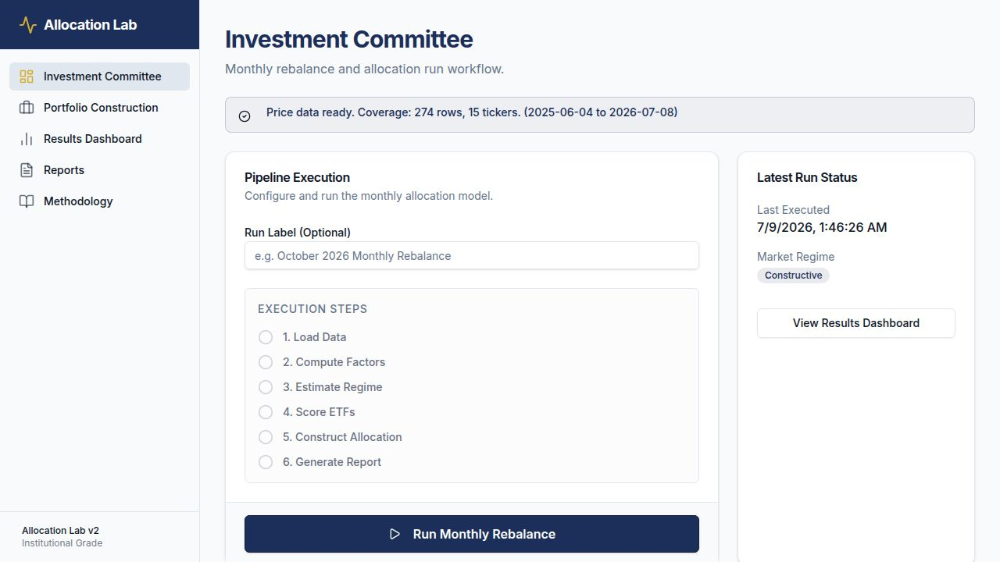
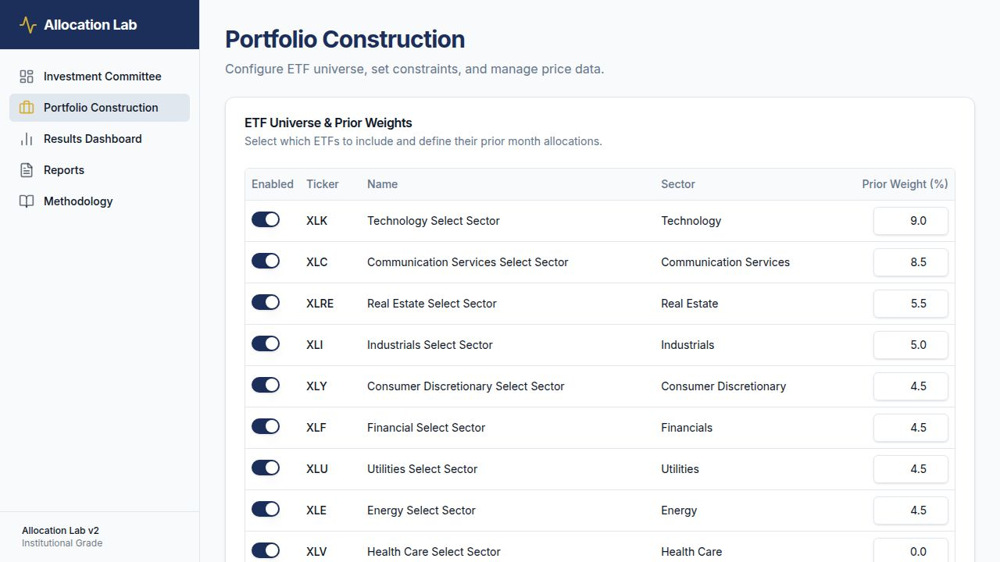
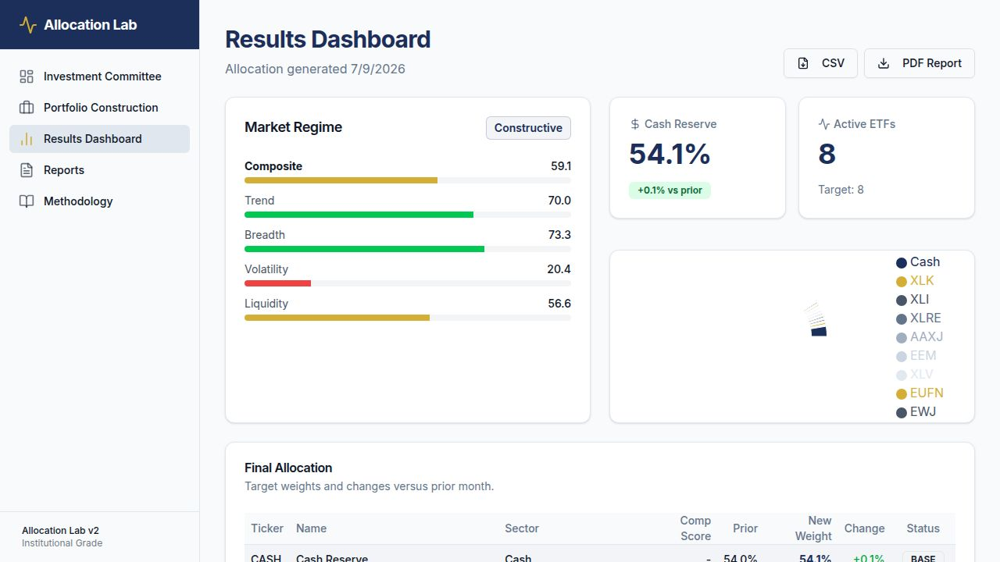
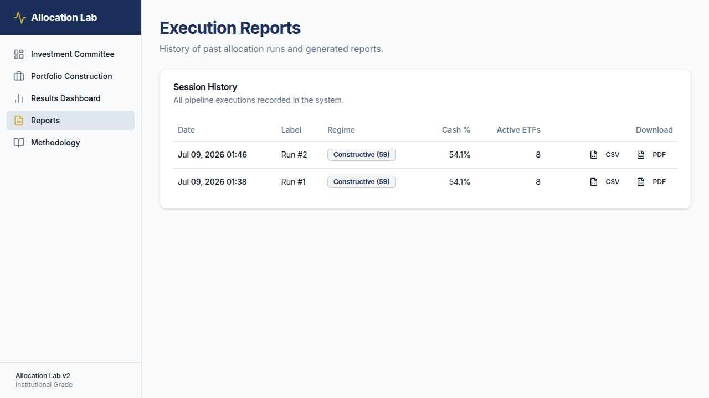
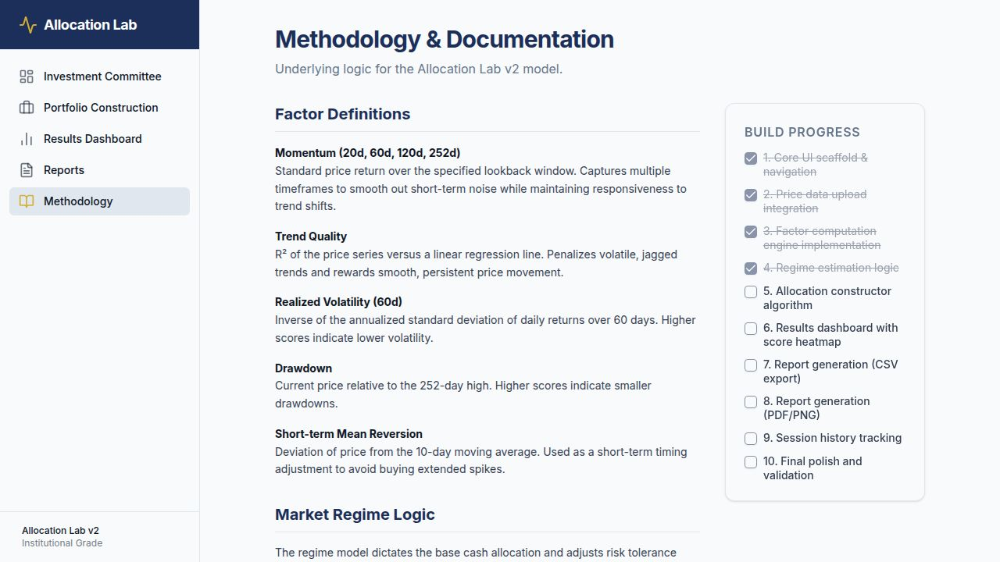

# Allocation Lab v2 — Product Overview

**Fecha:** 9 de julio de 2026  
**Stack:** React + Vite · Express 5 · PostgreSQL · Drizzle ORM · TypeScript  
**UI:** Navy #1B2F5B · Inter · shadcn/ui · Tailwind CSS

---

## 1. Investment Committee


Punto de entrada principal. Con un clic en **Run Monthly Rebalance** se ejecutan los 6 pasos del pipeline:

1. Load Data — carga precios históricos desde la base de datos
2. Compute Factors — calcula momentum (20d/60d/120d/252d), trend quality, realized vol, drawdown, mean reversion
3. Estimate Regime — construye score de régimen compuesto (Trend · Breadth · Volatility · Liquidity)
4. Score ETFs — ranking cruzado 0–100 por factor y compuesto
5. Construct Allocation — aplica restricciones (cash 50–60%, max ETF 10%, mín 8 ETFs activos)
6. Generate Report — persiste la sesión en base de datos

El panel derecho muestra el **Latest Run Status**: fecha, régimen de mercado y acceso rápido al dashboard.

---

## 2. Portfolio Construction


Tres secciones:

- **ETF Universe & Prior Weights** — tabla de 17 ETFs con toggle enabled/disabled y peso previo editable. Cash reserve configurable.
- **Allocation Constraints** — cash min/max, max peso individual ETF, umbral de inclusión mínima, número objetivo de ETFs activos, diversificación sectorial.
- **Price Data Source** — botón **Refresh Market Data** para descargar precios ajustados desde Yahoo Finance (últimos 400 días, con retry y timeout por ticker), o bien subir un CSV manual. Muestra estado de cobertura de datos.

---

## 3. Results Dashboard


Resultados del último run:

- **Market Regime card** — score compuesto + subcomponentes (Trend, Breadth, Volatility, Liquidity) con barras de color.
- **Cash Reserve card** — peso actual y delta vs. mes anterior.
- **Active ETFs card** — conteo vs. target.
- **Donut chart** — distribución de la cartera.
- **Final Allocation table** — ticker, sector, composite score, peso previo, peso nuevo, cambio, status (ACTIVE / —).
- Botones de descarga **CSV** y **PDF Report** en la cabecera.

---

## 4. Reports


Historial de todas las ejecuciones del pipeline almacenadas en base de datos. Por cada sesión:

- Fecha y hora de ejecución
- Label (personalizable)
- Régimen de mercado y score compuesto
- Cash % y número de ETFs activos
- Descarga en **CSV** (datos tabulares) o **PDF** (informe formateado con cabecera navy, tabla de allocations, footer)

El PDF se genera server-side con `pdfkit`. Cada descarga obtiene un token de corta duración (10 min) antes de abrir el archivo.

---

## 5. Methodology


Documentación interna del modelo:

- **Factor Definitions** — Momentum multiperíodo, Trend Quality (R² vs regresión lineal), Realized Volatility (inv. de desv. estándar 60d), Drawdown (precio vs máximo 252d), Short-term Mean Reversion (desviación de MA10).
- **Market Regime Logic** — cómo el score de régimen ajusta el nivel de cash base.
- **Build Progress checklist** — 10 ciclos de construcción, los completados aparecen tachados.

---

## Arquitectura

```
pnpm workspace (monorepo)
├── lib/api-spec/openapi.yaml     ← contrato de API (fuente de verdad)
├── lib/db/src/schema/            ← Drizzle schema (config, price_data, sessions)
├── lib/api-zod/                  ← Zod schemas generados por Orval
├── lib/api-client-react/         ← React Query hooks generados por Orval
├── artifacts/api-server/
│   └── src/
│       ├── lib/calculator.ts     ← motor de cálculo (factores, régimen, allocations)
│       ├── lib/yahoo.ts          ← descarga Yahoo Finance v3 con retry/timeout
│       └── routes/               ← universe, constraints, prices, live-prices, run, sessions, reports
└── artifacts/allocation-lab/
    └── src/pages/                ← 5 páginas React (IC, Portfolio, Results, Reports, Methodology)
```

**Datos reales siempre** — la app bloquea la ejecución del pipeline si no hay datos de precios cargados. No se usan datos sintéticos ni placeholders.
